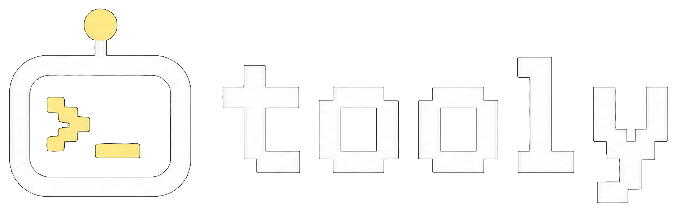

# Tooly



A terminal chat agent built with [Ink](https://github.com/vadimdemedes/ink) and the [Vercel AI SDK](https://ai-sdk.dev). Tooly talks to a model hosted on Groq (`openai/gpt-oss-120b`) and can call tools to work with your files, run shell commands, and search the web.

## Features

- Interactive chat UI in the terminal
- Tool calling with live status for each call
- User approval prompt before destructive actions (`deleteFile`, `shell`)
- Automatic context compaction when the conversation nears the model's context limit, with a context meter in the UI
- Evals for tool selection and multi-turn behavior, run with [Laminar](https://www.lmnr.ai)

## Tools

| Tool | Description | Approval |
| --- | --- | --- |
| `dateTime` | Get the current date and time (ISO) | No |
| `listFiles` | List files in a directory | No |
| `readFile` | Read a file's contents | No |
| `writeFile` | Create, update, or overwrite a file | No |
| `deleteFile` | Delete a file | Yes |
| `shell` | Run a shell command on the host machine | Yes |
| `webSearch` | Groq browser search | No |

## Requirements

- Node.js 20+ (or Bun)
- A [Groq API key](https://console.groq.com/keys)

## Setup

```bash
npm install
```

Create a `.env` file in the project root:

```bash
GROQ_API_KEY=your_key_here
```

## Usage

```bash
# Run from source
npm run dev

# Or build and run
npm run build
npm start
```

The build also exposes a `tooly` binary (`dist/cli.js`) through the `bin` field in `package.json`. Run `npm link` to use it as `tooly` from anywhere.

## Scripts

| Script | Description |
| --- | --- |
| `npm run dev` | Run the CLI from source with `tsx` |
| `npm run build` | Compile TypeScript to `dist/` |
| `npm start` | Run the compiled CLI |
| `npm run typecheck` | Type-check without emitting |
| `npm run generate:logo` | Regenerate the terminal logo from `assets/logo.png` |
| `npm run eval` | Run the evals in `evals/` |

## Project structure

```
src/
  cli.tsx          Entry point
  app.tsx          Main Ink app and chat state
  components/      UI components (input, messages, approvals, header, ...)
  agent/
    run.ts         Agent loop and tool approval handling
    model.ts       Model configuration
    system/        System prompt
    compaction/    Context compaction
    tools/         Tool definitions
evals/             Datasets, executor, evaluators, and scorers
scripts/           Utility scripts (logo generation)
```

## Safety

The `shell` tool runs commands directly on your machine. Tooly asks for your approval before running a shell command or deleting a file, so review each request before accepting it.
